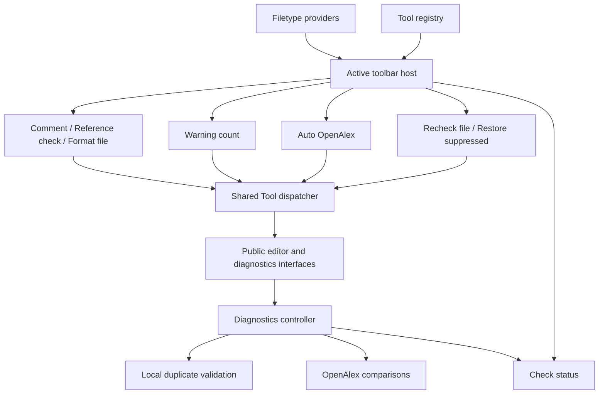

# Research Workbench user and extension reference

For installation and an overview, see the [project README](../README.md).
This guide preserves the detailed usage and extension documentation.

A standalone, offline Research Workbench with a local browser interface. Python 3.10 or newer is the only requirement; PDF.js, pdf-lib, fonts, and decoders are bundled. No npm install, Python packages, accounts, or online services are needed.

LLMs and scripts can create every supported markup type through the local HTTP API. See [API.md](../API.md) for exact source targeting, PDF coordinates, request examples, replies, status changes, deletion, and concurrent editing behavior.

## Development and modular architecture

Contributor entry point: [CONTRIBUTING.md](../CONTRIBUTING.md). See the
[detailed modularization migration plan](../docs/MODULARITY_MIGRATION.md) for the
current architecture, target ownership, ordered migration phases and acceptance
criteria. [Developer documentation](../docs/README.md) indexes the directory-level
extension guides, including [browser tools and file types](../static/README.md),
[maintenance commands](../tools/README.md) and [tests](../tests/README.md).
See [implementation status](../docs/MIGRATION_STATUS.md) for completed module
extractions, compatibility changes and remaining work.

## Launch

```sh
cd /path/to/research-workbench
python3 research_workbench.py
```

The browser opens at http://127.0.0.1:8766. Keep the terminal running. Stop with Ctrl+C.

Optional flags:

```sh
python3 research_workbench.py --project ~/Documents/MyPDFProject --port 8767 --no-browser --settings /tmp/editor-settings.json
```

## Use

1. Click **Choose folder…** for the macOS folder chooser, or enter a folder path and click **Open folder**. Typed paths can create new folders. The most recent folder reopens on launch.
2. Select the destination folder and click **Import files**, use **Import Files…** in that folder's actions, or drop files onto its row. PDFs and other files are copied directly there with their original names, without an extra folder. Existing filenames are rejected rather than overwritten. Imports support files up to 200 MB; PDFs are validated. Opening a PDF creates its review history while keeping it in its imported location.
3. Select a document. Use **Highlight** to select text, **Remove text** (shortcut R) to strike through selected words, **Replace text** (shortcut T) to strike through a selection and enter its replacement as a comment, **Pen** to draw, **Eraser** to remove marks, and **Undo** to undo additions/removals. Click a highlight or strikethrough to add or edit comments. You can also choose **Remove text** or **Replace text** from the menu after selecting text. For a replacement, type the new wording and click **Save replacement** (or Cmd/Ctrl+Enter); it is saved as a “Replacement:” comment and exported as a PDF note alongside the strikethrough. Strikethrough marks a suggested deletion; it does not erase or redact the underlying PDF text. Use the zoom controls or **Fit**. The page box next to the zoom controls shows the current page and the page count (“3 / 12”); type a page number and press Enter to go there. The same box is in the LaTeX workspace PDF.
4. Editable highlights, strikethroughs, comments, and strokes save automatically in `.research-workbench/`. Wait for **Annotations saved** before closing the browser. Document and project switching wait for pending saves; failed saves keep the current document open.
5. Click **Save PDF** (or Cmd/Ctrl+S) to write an annotated copy to `annotated/`. **Open saved PDF** opens that export. Changes made afterward require another **Save PDF**; the library labels outdated exports.
6. **Copy all** in the toolbar copies every mark and its comments in reading order (page, then top to bottom), with the PDF's location and instructions for an AI assistant: address every comment, check it against the evidence, ask when a comment is unclear (or ask for the thinking behind it), and change nothing else. This works for any PDF; no LaTeX source is needed.
7. Reopen the same project folder and select a document to continue editing. The editor loads the untouched original plus editable annotation data, so marks do not accumulate on every export.
8. When files change on disk outside this tab (another tab, a script, an agent editing the LaTeX source), click **Reload from disk** (↻, next to the theme toggle). It saves pending marks, re-reads `library.json`, annotations, the linked source files and the draft PDF, and keeps the project, folder filter, open paper, view, zoom and scroll position. If a newer version of the open paper appeared, it opens that version. Source tabs with unsaved edits are flagged instead of overwritten.

Click **New folder** beside the **Folders** filter to group related papers. Open a paper and use **Move to folder** to move it and all its versions together. Choose **All papers**, **Unfiled**, or a named folder in the sidebar. These older collection controls organize review records in the project index. Use the file tree's real folders for import placement and filesystem moves.

The library displays one active (latest) version per paper. Use **Document actions (⋯) → Version history** above an open paper, or the **Version** dropdown inside a document card, to open earlier versions, including their original marks, comments, and saved PDF exports. Archived versions are read-only. New uploads start with empty editable annotations and no inherited export; comments are never transferred onto a different PDF. Any marks already embedded in the uploaded file itself remain part of that original file. Pending annotations on the open version are saved before it is archived. If another tab has replaced a version, stale edits are rejected to preserve its history.

Existing libraries upgrade automatically with a backup of the previous index in `.research-workbench/`. Existing PDFs, exports, and notes remain in place; existing numbered copies remain separate papers and are not automatically merged. Their existing filenames remain visible so you can choose the correct paper when adding a new version.

Use **Delete** under a document in the library to remove it from the list, then confirm. Deleting a paper removes all its versions from the active list. Deleting the open paper first saves its editable annotations and closes the viewer; restoring brings back its full history. Check **Deleted documents** to see removed items and click **Restore** to bring one back. Deletion is recoverable: PDFs and annotation files remain in their existing folders, and the library records the deleted state. External source files are never deleted. There is no permanent-delete action.

Project layout:

```
chosen-project/
  originals/          # untouched PDFs imported before versioning
  annotated/          # exports created before versioning
  versions/
    <version-id>/
      original.pdf    # untouched original for this version
      annotated.pdf   # optional export for this version
  .research-workbench/        # folders, history, index backups, and per-version editable notes
```

Keep the entire project directory together when moving or backing up a project. Reimporting an exported PDF treats it as a new original: its baked-in highlights and ink cannot be erased; original editable annotations remain available through the project library. PDF comments are exported as standard PDF note annotations. Password-protected PDFs are not supported. Imports perform basic PDF validation; the viewer reports PDFs it cannot decode.

Use one server process per project folder. Multiple tabs of the same server may use different folders safely; avoid simultaneously editing the same document in multiple tabs (the last save wins). The server listens only on this computer and protects write requests with a per-session token.

## Projects and file navigation

The app opens on the **Research desk**, with a project overview, a compact project
list and recent files. **Add project** opens a folder picker or accepts a new folder
path. Opening a new path creates a local project. The registered project list survives
server restarts; opening the app without a deep link starts at the workspace overview.

Select a project to open its overview and automatically switch the single sidebar to
**Files**. The **Projects / Files** toggle at the top switches between workspace
navigation and the active project's file tree. Switching panels keeps the current
editor and unsaved buffers open. Expand folders to see papers, linked LaTeX sources
and directories on disk, such as `Reading/Methods/`. The header button collapses the
whole sidebar when more room is needed. The workspace **Project overview** returns
to all projects after saving pending edits; the project **Project overview** returns
to the current project's papers.
**Folders and versions** contains the existing folder, version and recovery controls.

Open **Settings → Writing** to choose US English, UK English, Nederlands or Off.
The app remembers your choice in the current browser or macOS app and underlines
possible misspellings in LaTeX, Markdown and plain text using bundled dictionaries.
US English is the default.
Right-click an underlined word and choose a spelling suggestion to replace it.
Use Undo to restore the original word.
Choose **Add to dictionary** to accept the word for the selected language. Added
words are remembered in the current browser or macOS app across reloads.
Under **Personal dictionary** in Writing, choose which language to view and click
**Remove** beside a word to check it again in that language. The spell-check
language and the dictionary you are viewing have separate controls.

Hover a disk file or folder and left-click **⋯**, or right-click its row, to open
explorer actions. **Show in Finder** reveals any file, folder, review PDF, or the
project root on macOS. The project root has an actions button but cannot be
renamed, moved, or deleted. Folders provide **New File…** and **New Folder…** in that exact
destination. Disk entries provide **Rename…**, **Move to Folder…**, **Copy Relative
Path** and **Delete…**. Keyboard equivalents are **F2**, **Delete**, and
**Shift+F10** for the menu. Delete asks for confirmation and retains the item and
its contents in `.research-workbench/trash/`; the status message gives its recovery path.

Drag a file or folder onto another folder's row to move it, or onto **Project
root** to move it out of a subfolder. A highlighted row marks a valid destination.
Moves stay within the same project/source root and reject cycles and occupied
names. Open edits save before a mutation and the view returns to the project
overview so old editor buffers cannot write to moved paths.

Use **Import Files…** in a folder's actions or drop external files onto its row to
import directly there. The toolbar imports into the selected folder, or the folder
of the opened file; the project root is the default. PDFs appear as files without
automatically created wrapper folders. Existing PDF review history is retained. Older archive-only imports also provide
**Rename…**, **Move to Folder…**, and dragging. Their first move or rename creates
a regular project file at the chosen location while preserving every review version.
Virtual paper collections retain their existing controls. Linked source roots and configured
main files are protected; LaTeX include paths and review-note references are not
rewritten by ordinary moves.

Unavailable project folders stay registered and cannot be silently recreated by opening
a project from the overview.

Select a `.tex` file belonging to a linked paper to open the existing LaTeX workspace,
including formatting, comments, tracked changes and PDF navigation. Select a PDF to
open the full PDF review viewer with highlights, comments, replacements, pen and
eraser. The sidebar stays available beside either tool. Source files must first be
linked through **LaTeX workspace**; other file types are listed for context and do not
yet have an editor. Hidden files, symbolic links and generated review storage are
excluded from the tree. Trees are limited to 5,000 entries and 20 directory levels.

A PDF opened directly from a directory is copied into the project's version storage.
Opening it again reuses its editable review. If its bytes change on disk, opening it
creates a new version while preserving the previous PDF and its comments. The PDF
on disk is never overwritten. **Save PDF** writes the annotated export to the managed
version directory. PDFs inside linked source folders follow the same rules.

Source edits save before switching projects or viewers. If a save conflicts or
fails, the current editor stays open. The browser remembers the last open document
and source file for each project, and expanded file branches. PDF annotations keep
their existing automatic save behavior.

Project contents remain in the chosen directory: `.research-workbench/` stores the paper
index, folders, annotations and source review data; `versions/` stores immutable
imported PDFs and annotated exports. Linked LaTeX files stay in their source folder
and are edited there. The app's settings file records project folder locations, not
copies of project contents. Back up the whole project directory and any external
linked source folders together.

## LaTeX workspace

For papers written in LaTeX in a git repository, the latest version opens in a workspace: the LaTeX source on the left, the draft PDF on the right, comments and changes in a review panel beside the source. Requires `latexmk`, `pdflatex`, `synctex` (TeX Live or MacTeX) and `git`. Nothing becomes a version until you save one.

1. **Link once.** Open the latest version and click **LaTeX workspace**. Give the folder that holds the main file (absolute, or relative to the library folder), the main file and the git commit this version's PDF was built from. Linked papers then open in the workspace; **PDF review** shows the version's PDF with its review comments as before.
2. **Edit.** Open LaTeX files from the project sidebar; the active file tab appears first, directly above its editor. Cmd/Ctrl+S saves, Cmd/Ctrl+Enter (or **Recompile**) saves all files and rebuilds. The toolbar above the source formats the selected text: bold `\textbf{}` (Cmd/Ctrl+B), emphasis `\emph{}` (Cmd/Ctrl+I), monospace `\texttt{}`, quotation marks ``` ``…'' ```, citation `~\cite{}` (Cmd/Ctrl+Alt+K; the selection is the key), cross-reference `~\ref{}` (the selection is the label) and footnote `\footnote{}`, plus comment out or uncomment the selected lines with `%` (Cmd/Ctrl+/). A citation or reference replaces the space before it with `~`; a footnote attaches to the previous word. Without a selection a button inserts an empty command at the cursor; on text already wrapped by that command it removes the command. Each change is one undo step. When the source pane is narrow, the buttons that do not fit move into the **⋯** menu. **Citations:** while you type a key inside `\cite{…}` (or after **~\cite** with nothing selected, or with Ctrl+Space), a search field with autocomplete shows the matching entries from the `.bib` files the paper names in `\bibliography{…}` or `\addbibresource{…}` (every `.bib` in the source folder if it names none): key, authors, year and title. Search by bibkey, title, author or year using current, unsaved bibliography buffers. Choosing a result inserts its bibkey and completes a missing closing brace. Arrow keys choose, Enter or Tab inserts, Esc closes. Empty `\cite{}` and keys that are not in the `.bib` get a red underline, a warning at the top of **Review** (click one to jump to it), a ⚠ count on the **Review** button and a red status line after each build. **Copy all** lists them under “Citation problems”. The check also names `.bib` files that are missing and keys defined twice. With **Live** on (default), the workspace saves and rebuilds about 2 seconds after you stop typing. Saving and recompiling only write the working tree; nothing is committed until **Save as V…**. Errors show as a red count; click it for the log, and click a `file:line` to jump there.
   The arrow attached to **Recompile** opens **Compile active file**. This saves the open files and builds the selected `.tex` file as its own document. The PDF pane shows a read-only preview labeled with that file’s name. The file must contain its own `\documentclass` and document environment; ordinary section fragments should use **Recompile**. Preview output goes to a separate temporary folder and does not change the draft PDF, paper build history or versions. **Compile active file** builds the selected source tab. While a preview is displayed, **Live** rebuilds that preview’s file after edits, even if another source tab is selected. Outside a standalone preview, Live rebuilds the full paper. **Recompile** and Cmd/Ctrl+Enter always build the full paper and return to it. **Show paper** returns without building. Both paper and standalone builds show a spinning icon, **Recompiling…** and the target being built. The build controls remain disabled until the build finishes. Edits made during a build queue another build of the same target. If a preview update fails, the last good PDF stays visible with an update-failed notice.

3. **Move between source and PDF.** **Source | Both | PDF** in the header shows one pane or both; double-clicking the PDF or starting a comment from it brings the source back. Double-click PDF text to open its source with the word selected. The arrows on the divider go from the cursor to the PDF (→) and from the PDF selection or page center to the source (←). Drag the divider to resize.
4. **Comment, linked.** Select text in the source or in the PDF. The same menu appears next to the selection in both: a highlight color, **Remove text**, **Replace text** (asks for the replacement) and **💬 Comment** (Cmd/Ctrl+Alt+M in the source). On the PDF the toolbar tools work too. Each becomes one comment anchored in the LaTeX source, shown in the source, on the PDF and in the panel; clicking it in one place selects it in the others. Comments follow edits; if the passage itself is rewritten the comment says “text changed”. Reply, resolve and reopen in the panel.
5. **Hand the review to an AI assistant.** **Copy all** in the PDF toolbar (or the copy icon at the right of the review panel tabs) copies all open comments and changes that are not accepted, in reading order (the main file, then its `\input` files in order) as Markdown. It includes the source folder, the draft PDF, the review data file, each item's file, line and PDF page, and instructions: address every comment, check every change against the evidence, ask when a comment is unclear (or ask for the thinking behind it), and do not commit. Resolved comments and accepted changes are left out; the text says how many. If the browser refuses to copy, the text opens in a box with a Copy button.
6. **Source view and word count.** Each source file opens in the same LaTeX editor with its own undo history, comments, formatting and writing checks. The active file tab is first and is connected to the editor column. Select other files in the project sidebar. Cmd/Ctrl+S saves the active file, while Recompile saves all open files. The former Entire paper button and Files dropdown have been removed.
   The page header always shows the whole-paper count (“Paper: 6,036 words”). When editing individual files, it also shows the open file’s count (“219 words”); a selection shows its own count. Only files reached from the main file count; `\includeonly` is honored. Missing or circular inputs are reported above the combined source and mark the count as approximate. This follows literal file paths, without evaluating TeX macros or conditionals. Only running text and footnotes count. Headings, captions, commands and their arguments, references, math, comments, alt text (`\Description`) and front matter do not count; “human--robot” is two words and “3.5” is one.
7. **Writing.** The **Writing** tab in the review panel checks the active source view with fixed rules from the writing guide. Scores update after edits and disk reloads. **Comment** anchors the selected passage to its source file. Marks are tinted markings in the source, shown only while the tab is open; clicking a mark in the list emphasizes it; the PDF stays clean. Next to the file name is its word count, as in the page header (item 6). The tab shows Reading ease (Flesch), grade level (Flesch–Kincaid) and words per sentence for the active file, and one chip per check with its count: long sentences (over 25 words), comma chains (two or more commas), parentheses, intensifiers, plain-word alternatives, hype, British spelling, page numbers in citations, and two possible issues marked “?” (passive voice, a bare “this”). Only long sentences and comma chains are on at first. **Ignore** hides a mark for that sentence until the sentence changes; **Comment** turns it into an ordinary comment. The same text always gives the same marks. Front matter and layout commands are not prose and are left out of marks and scores: `\ccsdesc`, `\keywords`, the author block, `CCSXML`, `\fancyhead`, `\setlength` and similar commands, with all their arguments. Scores use the standard formulas; on the hallmark paper the syllable totals are within 1.5% of the `textstat` Python package in every section.
8. **Pen and eraser.** Pen strokes are anchored to the printed words nearest their start and move with that text after a recompile. The eraser removes your marks and strokes (kept in the history; Undo/Redo in the PDF toolbar). Tracked changes cannot be erased; use Revert.
9. **Changes.** Every difference from the version's commit is a change (Replaced, Added, Removed), marked in the source and on the PDF, with accept, revert, history and a thread. An accepted change leaves the Changes list and its marks in the source and on the PDF; **Show accepted** brings them back, with **Reopen**. The Changes tab counts only changes that are not accepted; the Comments button counts open comments. To read without change marks, turn off **Changes** (next to **Comments** in the footer): the marks leave the source and the PDF, the Changes list stays, and the choice is remembered. Edits made outside the editor are labeled so. A change inside a figure or table but outside its caption text (the image, `\Description`, layout) is marked on the first line of the caption (“Fig. N. …”) instead of over the whole float; edits to the caption text are marked on the edited words.
10. **Save as V*n*…** (**Document actions → Version history**) commits only the changed `.tex` files on the current branch, builds the PDF from that commit and imports it as the next version. If anything fails, nothing is committed. Nothing is pushed. Open comments continue in the new draft; resolved comments, strokes and change history stay with the old version.
11. **Hide images.** To see how many pages the paper takes without its figures, open **More** in the PDF pane bar and click **Hide images**. The workspace builds the files on disk a second time with every `figure`, `figure*` and `teaserfigure` (the acmart teaser) removed whole: image, caption, `\Description` and label. Tables stay, and so do images outside these environments. A reference to a removed figure prints as “??”. The PDF pane then shows this build, read-only, and the toolbar shows both page counts (“14 pages without figures · 17 with”). Hover over the counts to see which floats were removed. While **Hide images** is on, each build (Live or **Recompile**) also makes the PDF without figures, at the same time as the draft PDF. Comments, changes, the pen and the source/PDF arrows work only on the draft PDF; turn **Hide images** off to use them. It is off when the workspace opens. If the build without figures fails, the toolbar says so and **Log** shows the errors. This build runs in a temporary folder outside the library and the source folder, removed when the server stops. The `.tex` files, the draft PDF, the build history and versions do not change. It needs LaTeX 2020-10 or newer.

Choose **System**, **Light**, or **Dark** from the previews in **Settings → Appearance**
or from the **Appearance** menu in the sidebar footer. Changes apply immediately
and synchronize across open tabs in the same browser. **System** follows the
device appearance. Workbench remembers the light and dark color schemes separately
and shows both in the System preview. Compare the color scheme cards for the active
appearance, then click a card to apply it immediately. The palette below shows
the colors of the selected scheme.

Limits: SyncTeX finds lines, not words, so the editor matches words to place marks. The acmart abstract maps to `\maketitle`. Text inside figures and tables may not get a PDF mark; it is still listed. Marks that are not placed exactly say “position approximate”.

Draft files in the library folder:

```
.research-workbench/
  sources.json                    # paper → LaTeX source folder and main file
  drafts/<paper-id>.json          # changes, comments (notes), pen strokes, save log, builds
  drafts/<paper-id>/published/    # latest successful draft PDF and SyncTeX data
  drafts/history/<version-id>.json        # draft records after a version is saved
  drafts/history/<version-id>-draft.pdf   # last draft PDF before that
```

**Hide images** builds are not in the library: they go to `research-workbench-no-figures-*/<paper-id>/` in the system temporary folder.

Tools (for example an AI assistant) can read `drafts/<paper-id>.json` and reply through the running editor (session token from `GET /api/config` in `X-PDF-Token`): `POST /api/projects/<project>/documents/<version>/draft/notes/<note-id>/comments` or `…/draft/changes/<change-id>/comments` with `{"text": "...", "author": "..."}`.

## GitHub and Overleaf

**Link to GitHub repo** in the project sidebar saves a GitHub URL, target branch and
linked LaTeX paper. Saving a link changes only this project's `.research-workbench/github.json`;
it does not change existing Git remotes or publish files. **Push commits** explicitly
pushes the reviewed committed source to that exact repository and branch, using this
computer's existing Git authentication. No credentials belong in the URL or the app.

Source folders nested inside a larger repository are exported through `git subtree split`
so parent files do not reach GitHub. The local branch and index stay unchanged. Git
rejects remote divergence; the editor never force-pushes. Uncommitted edits are not
included: save a version or commit them before pushing those changes. A push does not
publish editable review storage. If that storage was committed into the source tree,
the push is rejected until it is removed from tracking.

Overleaf can import this GitHub repository and synchronize using its own GitHub
integration. Its integration requires premium access and manual push/pull actions.
This editor's GitHub control pushes commits; it does not implement automatic two-way
Overleaf synchronization or pull/merge remote changes into the source folder.

## LLM tools and named PDF collections

Read [llms.txt](../llms.txt) before using the HTTP API. Discover projects with
`GET /api/projects` and files with `GET /api/projects/{id}/tree`. Import a local PDF
directory into a named collection with `POST /api/projects/{id}/imports/directory`:

```json
{"folder_path":"/absolute/path/to/papers","collection_name":"Related work","duplicate_mode":"error"}
```

The directory API supports `error` (default, no changes), `skip` or explicit `separate`
for matching filenames. It never silently creates new versions. Imports are staged,
validated and published together; invalid PDFs or failed index writes preserve the
previous project. Symlinks and managed review storage are excluded. Limits are 500
PDFs, 1 GB total and 200 MB per file. No source PDFs are modified.

The HTTP API also supports LaTeX source creation and SHA-checked text saves,
compilation, version creation, review marks and explicit GitHub pushes.
See [API.md](../API.md) for detailed contracts. Restart the local server after
backend updates.

## Original project preservation

This application was copied from `~/Projects/tmp/review-helper`. That original was left unchanged. The copied review workflow, schemas, documentation, tests, and existing paper/review data are preserved under `legacy/` and are not loaded or served by the editor. To annotate an old paper in the new editor, import its PDF. The old annotated PDF and editable annotation JSON remain in `legacy/reviews/` for reference. The active app contains no review steps, review ledger, or review-form dependencies.

## Tests

`python3 tools/validate_api.py` starts a separate loopback server and retains a test
project, source Git repository, PDFs and a request/assertion report under
`work/api-validation/<timestamp>/`. It exercises the HTTP workflows with real
LaTeX builds, PDF text extraction, bidirectional SyncTeX, version creation and a
real push into a local bare Git receiver. It also attempts one live OpenAlex lookup using a public DOI. Provider error cases
and native folder selection are controlled at their external boundaries; no
GitHub account is used. The existing editor's settings and projects are not used.
Requires `git`, `latexmk`, `pdflatex`, `synctex` and `pdftotext` on PATH.

```sh
python3 -m unittest discover -s tests -v   # includes LaTeX draft tests (skipped without TeX)
python3 -m unittest discover -s tests -p 'test_markup.py' -v  # API handlers, no listening port required
python3 -m unittest discover -s tests -p 'test_projects.py' -v  # registry and file-tree API
node tests/test_project_navigation.mjs     # file routing and save-before-switch
node tests/test_markup_sync.mjs           # concurrent browser/API edits and idle refresh
node tests/test_draft_match.mjs            # placing draft marks on PDF text
node tests/test_writing.mjs                # writing checks and readability scores
node tests/test_bibliography.mjs           # local reference search and explicit metadata checks
node tests/test_bibliography_diagnostics.mjs # inline warnings, cache, suppression and stale results
node tests/test_citation_search.mjs        # citation autocomplete, buffers, insertion and failures
node tests/test_combined_source.mjs        # combined editing, anchors, undo/redo and whole-paper scores
node tests/test_hide_images.mjs            # Hide images: toggle, page counts, which PDF the pane shows
# PDF lifecycle regression test (Node.js 26+):
node --experimental-vm-modules tests/test_annotator_lifecycle.mjs
node --experimental-vm-modules tests/test_strikethrough.mjs
```

## Bibliography editing and reference checks

Open `.bib` files from Project files in the source workspace. BibTeX syntax coloring,
SHA-checked saves, comments, tracked changes, and Save as version work like `.tex`.
Bibliographies are committed with source versions but excluded from prose word counts.
The **Reference check** tool appears only in the `.bib` file toolbar. Select a linked
bibliography and search its current entries by bibkey, title, author or year with
autocomplete, then use **Check reference** to compare the selected entry with OpenAlex.
Typing in either reference search never searches an external catalog. Exact DOI lookup and title-search candidates remain
clearly distinguished; discrepancies and missing fields are shown, never auto-applied.
The comparison covers title, DOI, year, author names/order, venue, volume, issue and pages.
BibTeX string macros and inherited cross-reference fields are not evaluated; review
those values against the original publication. OpenAlex metadata is not a correctness guarantee.

The bibliography editor also shows warnings directly under affected keys or fields.
Duplicate keys are checked locally in the current unsaved file. **Auto OpenAlex** is
enabled by default and checks complete unique entries when a bibliography opens and
after editing pauses, including newly added entries. Checks are serialized and paced
to about one request per second. Metadata comparisons are cached for seven days;
formatting or moving an entry does not spend another lookup. Missing DOI/title and
incomplete entries are skipped. Ambiguous or weak matches receive a work-identity
warning; field warnings require an exact DOI or a distinct strong title match. Missing
provider metadata never becomes a false mismatch. No suggested values are applied.

Use **Suppress** beside an inline warning to hide that rule for that key in the current
file. Choices survive browser reloads on this browser and are independent of source
line numbers. **Restore suppressed** restores this file's warnings. **Recheck file**
refreshes provider comparisons and retries failed requests. Disable **Auto OpenAlex**
to pause background requests while keeping local duplicate checks. Provider failures
appear in the warning controls separately from bibliography errors; automatic retries
pause for a minute. Storage failures are displayed and leave session-only suppression
available. Suppression and checking never modify the `.bib` source.

**Settings → Integrations** stores an optional OpenAlex key in a private mode-0600
companion to the server settings file (`.settings-openalex.json` by default, Git-ignored).
The key is never returned by the settings API or stored in browser storage. Basic
lookups can run without a key. Lookups send only the entry's DOI/title to `api.openalex.org`;
source parsing stays local. The backend
uses Python's standard library and the existing bundled CodeMirror 5.65.16 editor; no new
package dependency is required. Restart the Python server after updating backend code;

## Pane bars and toolbar extensions

Document identity and **Source / Both / PDF** navigation stay in the header.
Source formatting and reference checks belong to the source pane; annotation tools
belong to the PDF pane. Comments and change-mark toggles sit beside save status in the footer. BibTeX files hide LaTeX formatting. Recompile lives beside the PDF preview; page navigation and zoom stay in the PDF pane bar.
Source headers contain file tabs followed by one left-aligned editing toolbar.
Tab activation preserves opening order. Right-click a tab (or press Shift+F10)
for Close, Close Others, Close to the Right, Close Saved, Close Non-Pinned,
Close All and Pin/Unpin. Bulk actions preserve pins except explicit Close All.
Unsaved closes require one confirmation before any tabs change. Closing every file
tab leaves an empty read-only editor; opening a file enables editing again.
Menu actions are independent `Tool` subclasses registered in `workspace.tabs`.
`EditorTools.TabCloseTool` supports subclasses with static `label`, `select(owner, file)`
and optional `includePinned`; selection uses public `getOpenTabs()`, `isTabSaved()`
and `isTabPinned()` methods. `closeTabs()` owns confirmation and buffer disposal.
Source-only mode keeps Cmd/Ctrl+Enter for compilation; the button is visible in Both and PDF views.
Both panes use the same heading/toolbar heights, control targets and horizontal inset
from `static/toolbar.css`. Source tools, table insertion, PDF tools, overflow, tab-close
and build controls use `EditorTools.icons`: one 18px outline set with a 1.75-unit
stroke. Extensions can register path geometry with `icons.register(name, path)` and
use `icons.markup(name)` for command definitions or `icons.create(name)` for DOM controls.
There is no shared action row above the panes. Word counts,
save state, build logs and Live compilation are in the footer. PDF **More** contains
pen/highlight options, undo/redo, copying, export and preview settings. Saved versions,
including **Save as version**, are in **Document actions (⋯) → Version history**.

`static/toolbar.js` supplies `EditorTools.Tool` and an insertion-ordered registry.
Every registered tool must declare a nonblank `static label`; registration rejects
missing labels. The renderer supplies an accessible name (`aria-label`) and
`data-tool-label` automatically. `ToolUI` replaces native button titles with
application-styled tooltips after 150 ms, immediately on keyboard focus. Optional `static info`
provides longer hover help; existing descriptive titles and shortcuts are preserved.
Source command definitions also require a nonblank `label`. Standalone icon controls
use `EditorTools.ToolInfo.apply(control, {label, info})` for the same behavior.
Extend `Tool`, implement `create(context)` to return a native control, and register
its class with `EditorTools.registry.register(area, ToolClass, {views})` before that
view mounts. Available areas are `workspace.actions`, `workspace.build`,
`workspace.source`, `pdf.marks` and `pdf.navigation`. Workspace view names are `source`, `both`, `pdf`;
annotation view names are `pdf` and `review`. The context supplies `owner` and `view`.
`available(context)` restricts capabilities; `update(control, context)` refreshes
local enabled/pressed state. `ControlTool` adapts an existing owner node through a
static `control` property. Refreshing a workspace toolbar preserves its controls,
focus targets and event handlers. Registry code never saves or versions documents;
commands call the owning workspace/annotator, retaining its save guards and history.
No additional libraries or dependencies are required.

Bibliography files (`.bib`, case insensitive) are formatted whenever they are saved,
including saves made by Live compilation. **Format file** in the source toolbar or
**Shift+Alt+F** applies the same layout immediately. Fields appear on separate lines
with two-space indentation and aligned assignments; entries have blank separators.
Formatting removes `abstract` fields (case insensitive), collapses excess whitespace
in field values, and trims padding inside outer braces or quotes. Required word
spaces, escaped characters, keys, field order, record order, native line endings,
and existing trailing commas are preserved. Comments, `@string`,
`@preamble`, and `@comment` records remain literal; entries containing inter-field
comments retain their original layout while still removing abstract assignments.
Incomplete records are saved unchanged;
explicit formatting reports the syntax problem without changing the buffer.
Formatting supports undo/redo and retains the source selection and scroll position.

`static/source-formatting.js` supplies `SourceFormatting.SourceFormatterRegistry`.
Add a file type through `SourceFormatting.formatters.register('.extension', provider)`;
the provider implements `format(text)` and returns the complete formatted string,
throwing `SyntaxError` for incomplete syntax. The shared save hook and file-formatting
tool discover registered providers without changes to other file types or toolbar
commands. The initial provider supports BibTeX; other source files remain untouched.
This uses the existing CodeMirror **5.65.16** document/history APIs and no new libraries.


## LaTeX tables and toolbar extensions

The source formatting toolbar includes **Table** (inside **More formatting** when
space is limited). Set rows (1–100), columns (1–30), optional alignment (`l`, `c`,
`r` per column), caption, and label. A label requires a caption so LaTeX assigns
the correct table number. Select rectangular tab-separated text to convert it;
otherwise editable cells are generated. Selected text and captions are literal:
LaTeX special characters are escaped. Generated `table`/`tabular` environments use
standard LaTeX without additional packages. Edit generated source normally;
existing save, compile, comments and undo/redo workflows apply.

Formatting commands register independently through the public interface:

```javascript
window.EditorTools.sourceCommands.register({
  id: 'custom-command', name: 'Custom', label: 'Run custom command',
  icon: '<span aria-hidden="true">C</span>', group: 'custom',
  execute: workspace => workspace.editSelection((text, from, to) => ({
    from, to, insert: 'custom', selFrom: from, selTo: from + 6,
  })),
});
```

Register before the workspace mounts. The renderer supplies grouping, responsive
overflow, optional `key` shortcuts and error reporting. Additional commands need
no renderer or existing-command edits. `SourceCommandRegistry.list()` returns a
new array of immutable definitions; registry storage and LaTeX wrapper definitions
remain private. `Workspace.formatEdit(text, from, to, kind)` is the public pure
interface for built-in wrapper edits. `Workspace.insertTable(options)` and
`LatexTable.edit(text, from, to, options)` expose table editing without revealing
CodeMirror, escaping helpers, or internal state.

Other toolbar areas use `EditorTools.registry.register(area, ToolSubclass,
{views})`. Implement public `create(context)`, optional `available(context)` and
`update(control, context)` methods. Areas are `workspace.actions`,
`workspace.build`, `workspace.source`, `pdf.navigation`, `pdf.marks`, `pdf.actions`
and `pdf.options`. Owners supply public `getToolbarControl(id)` accessors and
capability methods. PDF tools use the immutable `getToolbarState()` snapshot and
public commands rather than reading owner fields. `ToolRegistry.mount()` returns
an element and `refresh(context)`; it retains existing controls across refreshes.
New registrations take effect on the next mount.

Use `registry.contributeGroup(area, {id, label, icon})` for an icon-only
dropdown. Add actions with `registry.contribute(area, definition, {group: id})`
or pass `childArea` to reuse a dedicated toolbar area. Grouped actions keep
their IDs and can still be invoked through `registry.execute`. The group label
appears on hover or keyboard focus and clears while the dropdown is open.

Lower-level validation, generation, registration and command dispatch throw.
`Workspace.runToolbarCommand()` and `PdfAnnotator.runToolbarCommand()` catch
synchronous failures and promise rejections at the interaction boundary. The table
form catches submit failures locally, preserves input and displays an accessible
error. Initialization cleanup rethrows so the interaction boundary reports it.
New and changed tool methods document `@param`, `@pre`, `@post`, `@return`, and
`@throws` contracts. No new third-party libraries were added; editor integration
continues to use the bundled CodeMirror 5.65.16.

```sh
node tests/test_toolbars.mjs
node tests/test_workspace_tabs.mjs
node tests/test_latex_table.mjs       # includes actual pdflatex compilation when installed
node tests/test_format.mjs
node tests/test_combined_source.mjs   # actual CodeMirror document edits and undo/redo
```

## Application-wide Tools and filetype providers

`Tool` is the interface for functional buttons throughout the application, including
project actions, tabs, dialogs, formatting and PDF actions. Every action is an
explicit executable Tool definition or concrete subclass. `Tool.bind(control, tool,
context)` installs the shared dispatcher on custom markup; no separate button
handler is retained. `Tool.activate(control)` invokes that operation directly for
keyboard and menu triggers. `ToolUI` only renders hover help and never creates or
adopts actions. The private association is readable with `Tool.forControl(control)`.
Formatting buttons and overflow items bind to the same source-command Tool. Form
submission and clicking use the same validated action through `Tool.submit()`.
Compound controls remain placement hosts for their individual actions.

For new ordinary actions, use the shared renderer rather than creating a button:

```javascript
EditorTools.registry.contribute('latex.tools', {
  id: 'latex.insert-example',
  label: 'Insert example',
  info: 'Insert example text at the current selection',
  icon: 'code',
  showText: true,
  text: 'Example',
  presentation: { background: 'soft', emphasis: 'normal', size: 'compact' },
  execute: ({ editor }) => editor.editSelection((text, from, to) => ({
    from, to, insert: 'example', selFrom: from, selTo: from + 7,
  })),
});
```

Definitions require a unique `id`, nonblank `label` and `execute(context)`.
`showText` defaults to false; an action without an icon must explicitly show text.
Visible text defaults to `label`. Optional `info` and `shortcut` describe hover help.
`shortcut` supplies both hover text and keyboard dispatch within the host’s
`keyTarget`. Portable `Mod` or `Ctrl/Cmd`, and explicit Ctrl/Cmd/Alt/Shift modifiers
are supported. Hidden or disabled Tools do not dispatch; disposal removes bindings.
Presentation accepts `background: transparent|soft|solid`, `emphasis:
normal|primary|danger`, and `size: compact|normal`. Optional `available(context)`,
`enabled(context)` and `state(context)` evaluate current capabilities. State supports
`selected`, `pressed`, `expanded` and `busy`. Tools refresh in place and dispatch
against the current context. A `run(command)` or legacy owner recovery handler
catches synchronous exceptions and promise rejections at the interaction seam.
`mount()` returns `element`, `refresh(context)` and `dispose()`.

New source contributions receive a frozen capability interface: `editor` supplies
selection reading, pure selection edits, saving and formatting; `fileType` and
`view` identify the current presentation, and `compile` exists when supported.
CodeMirror and mutable workspace storage are not exposed through this interface.
Existing custom subclasses continue to use the documented public owner methods.

`ToolUI` uses one delegated listener/observer lifecycle for the application, rather
than listeners for every tooltip. It observes explicitly bound controls, preserves detailed
labels, removes duplicate native button tooltips, stays within the viewport, and
releases pending help when controls disappear. Escape, activation, scrolling and
focus departure dismiss help. Descriptions preserve other `aria-describedby` IDs.
Call `dispose()` before replacing the application-wide UI. Configure the initial
hover delay through `new ToolUI(root, {delay: 150})`. File-tree labels use
`data-tooltip-delay="1500"` to reveal full filenames and folder paths after 1.5 seconds.
These labels do not intercept pointer events. Dragging clears pending or visible
help and suppresses it until the drag ends; ordinary action buttons retain their timing.

`FileTypes.registry` in `static/file-types.js` owns file identity, editor adapters,
capabilities and toolbar locations. It rejects duplicate IDs/extensions atomically,
normalizes extensions, and returns frozen definitions. Built-in PDF, LaTeX and
BibTeX providers delegate to existing implementations. The source host mounts
additional `latex.tools` and `bibtex.tools` contributions without renderer edits.
Markdown and plain-text providers in `static/text-file-types.js` demonstrate an
independent editor with `text.actions` and a Markdown-specific `markdown.tools` bar.

To add another UTF-8 filetype, register its browser provider and backend permission:

```javascript
FileTypes.registry.register({
  id: 'notes', label: 'Notes', extensions: ['.notes'],
  toolbarAreas: ['text.actions', 'notes.tools'],
  capabilities: { text: true },
  open: context => context.openText(),
});
```

```python
from file_handlers import FileHandler, handlers
handlers.register(FileHandler('notes', ('.notes',), editable=True))
```

Load provider modules before the relevant editor mounts (the explicit script list
in `static/index.html` is the composition root). Backend modules register before
serving requests. New filetypes require no navigation, renderer or existing-provider
changes. Custom editor providers can call `context.openSession(factory)` instead;
the factory receives authenticated `api`, project `base`, `message` and `onFile`.
Its adapter supplies `root`, `file`, `unsaved`, optional `sourceDocument`, and public
`openFile`, `saveAll`, `destroy`, `reconnect` and `refreshFromDisk` methods. Loading
and saving must succeed before navigation disposes the prior editor. An optional
`mount({headerSlot})` runs after the root is attached and navigation has rendered.
Use it to move shared controls into the document header and measure editors/PDFs
on the first animation frame. Keep candidate initialization independent of visible
header changes so failed navigation preserves the current editor. Factories are
selected through the provider, so adding an editor does not add a routing branch.

Independent text sessions keep private CodeMirror documents, per-file undo/redo,
selections, dirty state and save revisions. Ctrl/Cmd+S saves their open buffers;
leaving the editor saves before disposal. Conflicts preserve local edits. Markdown
has a Bold action; its preview is outside the current implementation. Existing
LaTeX/BibTeX formatting, automatic saves, review and compilation keep their existing
paths. Importing any file does not grant permission to edit, compile, review or
version it. Independent text edits are not automatically added to source-version
commits. The backend registry keeps these permissions separate.

Validation:

```sh
python3 tests/run_inprocess.py
node tests/test_tool_contract.mjs
node tests/test_filetype_navigation.mjs
```

The in-process runner uses the real HTTP handlers and existing assertions without
opening sockets. Run the normal unittest suite and `tools/validate_api.py` where
loopback binding is permitted to also cover transport. For real browser regression
checks, temporarily copy `tests/modularity-browser.html` into `static/`, open it
through the development server, and remove the temporary copy afterward. It uses
fixture-only persistence and checks editor switching, history, failed saves,
provider toolbars, tooltip timing, viewport placement and disposal. No dependencies
were added; editing uses bundled CodeMirror 5.65.16 and Python's standard library.
Restart the Python server after installing backend changes.

## Concrete action flow and bibliography toolbar

All loaded application modules declare button operations through `Tool` definitions
or subclasses. The old `ExistingControlTool` and automatic `Tool.adopt()` pathway
are removed. Existing custom markup keeps its geometry, but its operation now lives
in `execute(context)` and runs through one shared dispatcher. A Tool can be bound
to several views; each binding retains its own context. Subclasses implement
`execute(context)` and bind themselves with `Tool.bind(control, this, context)`.
Registered actions can also be invoked through `registry.execute(area, id, context)`.
Selection/canvas events and input editing remain editor interactions, not duplicate
button operations. Native file-picker clicks still target the file input.

`static/bibliography-tools.js` contributes five concrete Tools to `bibtex.tools`:

| Tool | Behavior |
| --- | --- |
| `BibliographyWarningsTool` | Show the unsuppressed count; activate to reveal the first warning |
| `AutomaticOpenAlexTool` | Accessible switch for automatic provider checks |
| `RecheckBibliographyTool` | Retry the current file's checks explicitly |
| `RestoreBibliographyWarningsTool` | Restore suppressed warnings; visible only when needed |
| `BibliographyStatusTool` | Compact progress/error status with full recovery details in hover help |

These contributions flow into the existing source toolbar beside Comment, Reference
check and Format file. They wrap within that same toolbar when the source pane is
narrow. The former diagnostics action row is no longer rendered. Inline source
warnings and individual suppression actions remain at the affected entries.

Workspace supplies an immutable `getBibliographyToolState()` snapshot and public
`runBibliographyOperation()` / `focusBibliographyWarning()` methods. Tools never
receive controller callbacks or CodeMirror internals. File and source-text guards
reject actions against stale diagnostics; the existing controller retains local
validation, OpenAlex scheduling, caching, suppression and persistence.



The registry/host composition is tested by adding independent LaTeX and BibTeX
contributions without modifying either renderer. The bibliography toolbar suite
covers all five contributions, immutable state, exactly-once execution, automatic
checking, recheck, suppression restoration, stable controls, filetype isolation and
disposal. `test_tool_architecture.mjs` rejects independent `onclick` bindings,
button click listeners outside the dispatcher, automatic adapters, and a duplicated
bibliography action row. Dependencies remain unchanged: bundled CodeMirror 5.65.16,
PDF.js/PDF-lib as before, and the Python standard library.


## Sort BibTeX entries

**Sort entries** in the BibTeX toolbar sorts citation keys alphabetically, ignoring
case. Equal normalized keys retain their original order. The action operates on
the current unsaved buffer as one undoable edit and follows the existing save
workflow. Sorting is explicit; it does not run automatically during saves.

Entry contents, native line endings, trailing inline comments, and adjacent
entry-comment blocks are preserved. A header separated by a blank line remains
at the top of its section. `@string`, `@preamble`, `@comment`, unstructured section
text, and entries with `crossref`, `xref`, or `xdata` fields form fixed section
anchors. Sorting never moves entries across those anchors, preserving macro scope
and classic BibTeX cross-reference ordering. Incomplete or structurally invalid
records report an error without changing the buffer. The caret follows its moved
entry when applicable.

`static/bibtex-sorting.js` provides the pure `BibtexSorting.sort(text)` and
`BibtexSorting.edit(text, from, to)` interfaces and independently contributes
`bibliography.sort-entries` to `bibtex.tools`. Its only integration change is the
script entry in `static/index.html`; existing tools, the registry, toolbar host,
filetype provider, formatter and editor implementations are unchanged. No libraries
were added; integration uses the existing CodeMirror 5.65.16 history.

```sh
node tests/test_bibtex_sorting.mjs
```


## Remove a project from the workspace

Each project in the sidebar and overview has a **Remove project** icon with hover
help. This works for unavailable folders as well as open projects. Confirming
removal forgets the workspace registration and its browser recent-file entry; it
does not delete folders, source, PDFs, annotations, saved versions or repositories.
Re-add the same folder to reopen its existing contents.

Removing the active project saves source and annotations before unregistering it
and returns to the workspace overview. A failed save or registry request preserves
the current editor. Removing another project leaves active unsaved work untouched.
The shared concrete `RemoveProjectTool` supplies both UI locations through the
normal Tool dispatcher. The authenticated backend operation persists registrations
atomically and rolls back in-memory changes if settings publication fails.

## Open LaTeX before a PDF exists

Open a `.tex` file in the project tree to edit it immediately. No paper import or
manual source link is required. **Compile PDF** (Ctrl/Cmd+Enter) saves every open
source buffer, builds the main document and associates the resulting PDF
automatically. A section can declare `% !TeX root = ../main.tex`; otherwise the
workbench uses the selected document or discovers the nearest unambiguous main
file. Compilation errors leave the source editor and previous PDF available.

With a Git baseline, the first successful build opens the existing source/PDF
review workspace. Without Git, the same LaTeX workspace retains its source and PDF preview panes. Compilation never initializes Git or creates commits. Later builds reuse
the same paper; original PDFs and explicit versions remain intact. Existing linked
source continues through its review editor and attribution rules.

All LaTeX and BibTeX source uses the existing `Workspace`: the source/PDF split,
resizer, tabs, formatting, citations, bibliography tools, save/undo history and build
log remain the same before and after the first PDF. `LatexSourceSession` supplies
only source transport through public methods (`open`, `request`, `compile`,
`reconnect`, `previewUrl`); it creates no editor, layout or buttons. Existing
`workspace.source`, `latex.tools`, `bibtex.tools` and `workspace.build` contributions
are reused. Before a review baseline exists, review/version/SyncTeX commands are
disabled. Successful Git linkage opens the normal review workspace while retaining
the active file and selected layout. The backend `StandaloneLatex` service selects
the root, invokes the existing compiler and publishes through project import/link
operations. Citation parsing is shared with linked papers.

## Source project structure and ZIP downloads

Compiling an opened LaTeX project preserves its original source folder structure.
Automatically associated papers remain in managed review storage, while the file
tree shows the original project files instead of adding virtual `main` /
`LaTeX source` folders. Existing folders are never renamed, moved or deleted. In LaTeX source subtrees,
`build` / `_build`, auxiliary TeX files and generated PDFs beside their matching
`.tex` source are hidden from the tree. Figure PDFs remain visible. Imported reading PDFs retain their normal paper
entries; `.tex` and `.bib` files still route to their linked editor.

Use **Download source ZIP** beside the compile controls to save open buffers and
export the sources, bibliography, classes/styles, figures and a freshly compiled
PDF. The ZIP preserves relative source paths and places the PDF beside its main
`.tex` file. Compilation uses an isolated snapshot of the exact exported source
bytes; it creates no Git commit, paper, version or source-folder build outputs.
Failed saves or builds prevent the download and retain the current editor.

The ZIP excludes internal review/version data, hidden/private files (except the
build configuration `.latexmkrc`), dependency/cache folders, `build` / `_build`
folders and auxiliary TeX build files. Figure PDFs are retained. Exclusions affect
only the download, not the on-disk project. Tree filtering also hides generated
LaTeX outputs without deleting them. Exports are limited to
10,000 input files and 200 MB including the compiled PDF. `SourceArchive` uses
Python's standard-library `zipfile`; no new dependency is required. The download
is an independent Tool contribution to `workspace.build` using the public
`downloadSource` capability.

## JPG, PNG and JSON files

Import `.jpg`, `.jpeg`, `.png` and `.json` files with the existing file import
action, or select them directly from the project tree. Images open in a read-only
preview with **Fit image**, **Actual size**, **Zoom in** and **Zoom out** Tools.
Natural dimensions appear in the status line. Switching or closing a preview
releases its image URLs; failed reads/decodes preserve the previous preview.

JSON opens in the existing UTF-8 text editor with syntax highlighting, Save,
Undo/Redo and **Validate JSON**. Saving uses the same SHA conflict checks as other
text files and preserves the exact text. Validation reports syntax errors without
rewriting numbers, dropping duplicate keys or changing undo history. Incomplete
JSON remains saveable while editing; validation is explicit. No new dependencies
are required: highlighting uses the bundled CodeMirror 5.65.16 mode API, image
decoding uses the browser, and backend reads use Python's standard library.

Providers live in `static/json-filetype.js` and `static/image-filetypes.js`; their
Tools contribute to `json.tools` and `image.view`. `ImageWorkspace` implements the
existing public editor adapter interface. Backend `FileHandler` declarations
explicitly grant image preview through `preview_mime` and `preview_signature`;
adding a provider does not change navigation or other filetypes. Images remain
read-only and never create paper/version records. Image reads use the existing
confined project/linked-source resolver, require a matching binary signature,
and are limited to 50 MB. Figure PDFs and LaTeX editing retain their existing
providers.

GitHub push failures report sanitized categories for SSH authentication, SSH host
verification, HTTPS credentials, DNS/connectivity, repository access, write access,
branch rules and diverged history. Local Git failures identify the operation;
raw remote and credential-helper output is never displayed. Failures do not retry
publication or use force. The dialog reports a failed push immediately and keeps
a confirmed success distinguishable from a later status-refresh failure.

To diagnose repository access without pushing or modifying the source, run
`git ls-remote git@github.com:owner/repository.git` in the terminal used to start
the server. The server disables interactive Git/SSH prompts, so that process must
already have access to the required SSH key/agent or HTTPS credential helper.


## Shared dialog panes

`static/panes.js` owns modal lifecycle and reusable form behavior. `static/dialogs.css`
styles every dialog, including transient dialogs mounted under `body`. Native
`<dialog>` supplies keyboard focus containment, background inertness and Escape.
`EditorPanes.open()` adds accessible heading wiring, initial focus, focus restoration
and optional disposal. Existing project, repository, version, bibliography, settings,
table and clipboard dialogs use that same entry point.

New form panes register a factory under a stable action name. A button Tool calls
`EditorPanes.open(name, context)`; replacing that registration changes the pane
without changing the button. Explorer rename, move and delete are working examples.
Domain operations remain outside the pane module and throw errors to its submission
boundary. Forms retain values on failure, announce errors, validate native required
fields, disable controls during submission and prevent duplicate submission or
Escape dismissal while saving.

```js
// Register in the feature module. No disk or network work happens until submission.
EditorPanes.register('research.rename', ({ item, rename }) => EditorPanes.form({
  title: 'Rename item',
  description: 'Choose a clear name.',
  fields: [{ name: 'name', label: 'Name', value: item.name, required: true }],
  submitLabel: 'Rename',
  onSubmit: ({ name }) => rename(item, name),
}));

// Bind in the caller. Register a different factory under the same name to swap panes.
EditorTools.Tool.bind(button, {
  id: 'research.rename', label: 'Rename item',
  execute: () => EditorPanes.open('research.rename', { item, rename }),
});
```

A custom pane factory returns `{ dialog, focus?, disposable? }` and builds its own
content. `dialog` must be a named native dialog; `focus` is an optional initial
control. Existing markup can call `EditorPanes.open(dialog, { focus, disposable })`.
The registry and active-pane tracking stay private. No third-party dependencies
were added; this module uses browser DOM APIs and the existing Tool module.

Validation: `node tests/test_panes.mjs`, `node tests/test_explorer.mjs`,
`node tests/test_latex_table.mjs`, `node tests/test_bibliography.mjs`,
`node tests/test_entry_creation.mjs`, `node tests/test_repository_dialog.mjs`.


## Workspace files and note citations

Each project is a workspace. Click **Workspace files** in the header from any
open file or the project overview. Search by filename or folder to open PDFs,
notes, READMEs, and other files in the current project, including linked source
folders. The picker reads the current project tree each time it opens.

From a `.txt` note, choosing a PDF opens it beside the note. Choose a different
PDF to switch the side pane. Workspace browsing leaves the note text untouched.
Other supported files open in Workbench. On macOS, files without an editor
open their location in Finder.

To save a reference in a `.txt` note, put the cursor where the link belongs and click the chain icon
**Add project file**. The picker lists the current project tree, including PDFs,
TXT files, READMEs, and files in subfolders or linked source folders. Choose a
file and click **Add file link**. Repeat for each source and save the note with
Ctrl/Cmd+S. Click any linked PDF to open it beside the note. Clicking another PDF
link switches the side pane. Other supported files open in Workbench. On macOS,
links to other file types reveal them in Finder.

For an exact citation, select a quote and click **Link quote to PDF page**. Select
the source PDF. Leave the page field blank to find the quote, or enter the
physical PDF page number (the cover is page 1). Repeated matches list their pages
for an explicit choice; scanned PDFs require a manual page.

Click the inserted **Source p. …** link to read the PDF beside the note. Linked
notes open with **Notes / Both / PDF** layout controls and a draggable divider.
Each linked quote is underlined and the matching PDF passage is highlighted in
the same color. Place the cursor in a linked quote and use **Quote underline
color** to change both. The quote-link dialog also accepts a color and an exact PDF
passage for paraphrases or transcription differences. Marks persist with the saved
note as source-link metadata; they do not rewrite the original PDF or review marks. Adding an optional comment stores the source inside the comment;
open **View comments** to follow it. Links remain tied to the original PDF revision.
Use **Raw Markdown** to edit/remove a link. Save the note with Ctrl/Cmd+S.

Click a highlighted passage or its comment marker in the PDF and choose a swatch
under **Highlight color**. A review highlight on the active PDF saves its color
with the PDF annotations. A linked quote updates the note underline and PDF
highlight together. Save the note to keep that change.


A source can be a **Quotation / transcription** or **Paraphrase / related context**.
Context links open the supporting page without highlighting different wording as a
verbatim quote. The PDF status counts each note quote once, even with several
source pages, and reports context-only entries separately. All quote underlines
are dotted; comments no longer determine the underline style.


## Shared project workspace

All files in a project are available together automatically through the sidebar
and **Workspace files**. No Add project file operation is required to associate them.
The text editor's **Workspace PDF** chooser lists the project's PDFs. A sole PDF
opens beside an unlinked note automatically; when several PDFs exist, select one.
Clicking a PDF in the sidebar while editing text also opens it beside that text.
Switching notes keeps the PDF open and preserves its scroll/zoom, each note's undo
history, and unsaved edits. Choose **No PDF** to return to the editor's usual preview.

**Add project file** inserts an optional written reference in a note. **Link quote
to PDF page** records an exact passage/page and highlight. Neither creates the
project workspace; its file membership comes directly from the project tree.
